# Emberwake — Story checkpoints

Where the game is up to, one screenshot per story checkpoint. Generated by
`tools/checkpoints.sh` from `data/scenarios.json` (at commit `f9170cb`, 2026-10-28 09:25 UTC).

Play from any of them: `godot --path . -- --scenario=<id>`, or in a debug build open the
pause menu (Esc) → **Chapter select (dev)**. `--scenario=list` prints them all.
Screenshots come from the sandbox's Compatibility renderer and look paler than the game.

## Act I — The Wake

### Wake on Shingle Point  (`--scenario=new_game`)

A brand-new game: the waking narration, Pell, and the humming pebble on the beach.

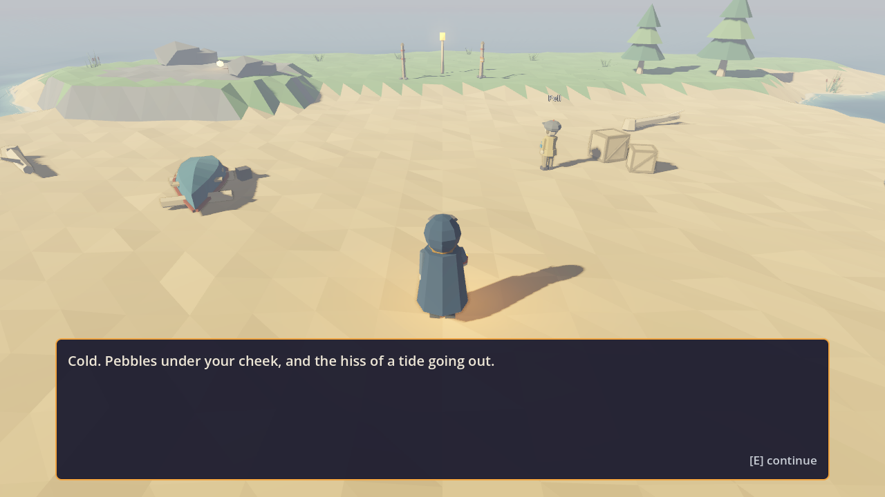

### Arrive in Saltmarrow  (`--scenario=saltmarrow`)

Pebble found and kept (Lost Things done). Meet Mara, Brother Aldous and Tam at the boardwalk gate.

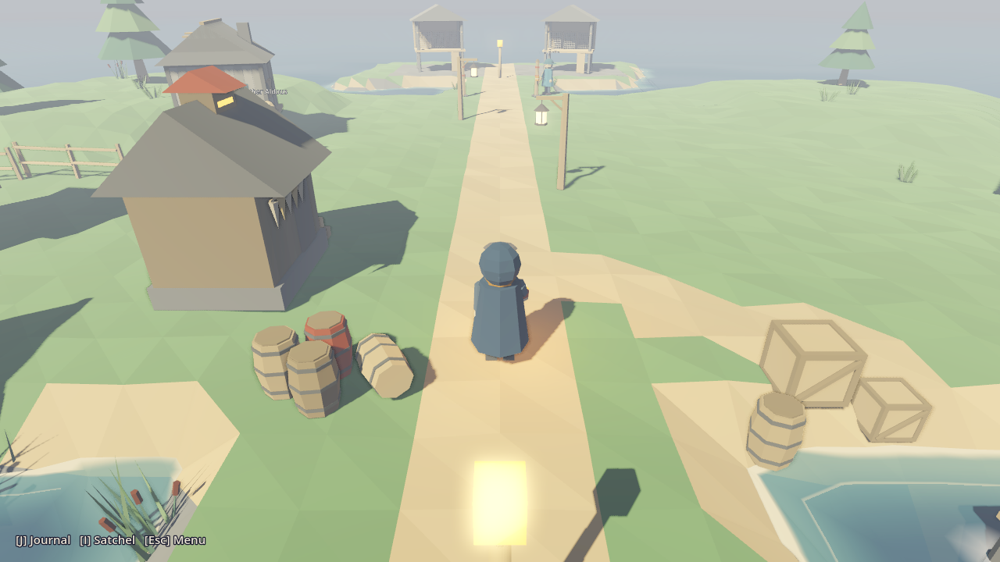

### Past the boardwalk gate  (`--scenario=gulls_head`)

Mara gave you her Harbormaster's Token and Aldous (treated gently) sent you to the beacon. Old Hesk, the greyed lofts, the Remembering Knot, and the dark headland deep in the Greying.

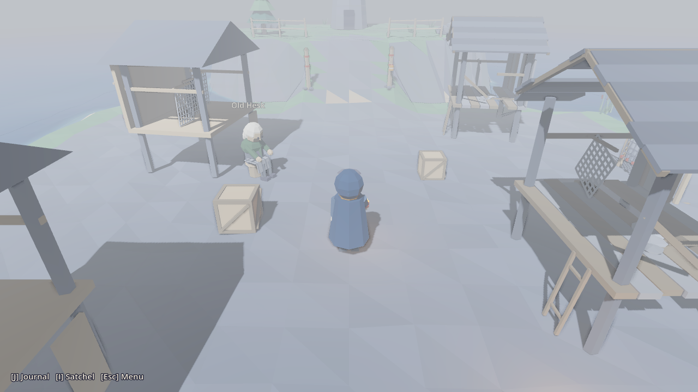

### The Burning  (`--scenario=the_burning`)

You carry the pebble and the knot, and Hesk's word about Dunstan. Walk up the ramp to the Gull's Beacon and choose what Saltmarrow forgets (or fetch Mara's whittled gull from her first).

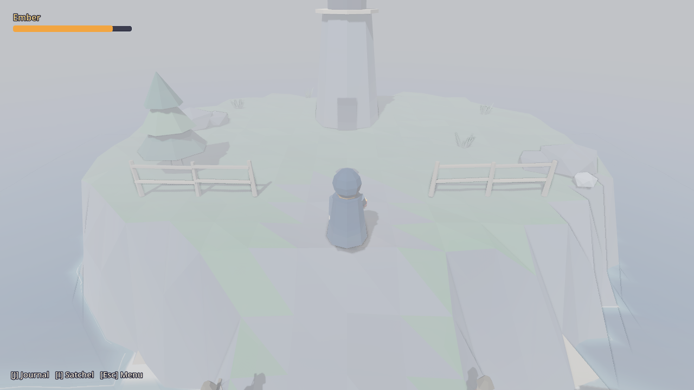

### After the burn: the lullaby  (`--scenario=aftermath_pebble`)

The Gull's Beacon burned the humming pebble. Saltmarrow after the burn: the light, the drying nets, Mara and Pell.

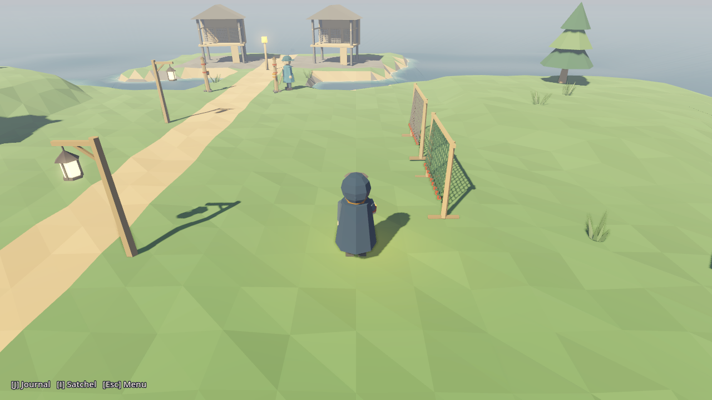

### After the burn: Mara's brother  (`--scenario=aftermath_gull`)

The beacon burned Mara's memory of Dunstan (the whittled gull). Two cups by the stool; nobody can say whose the dent is.

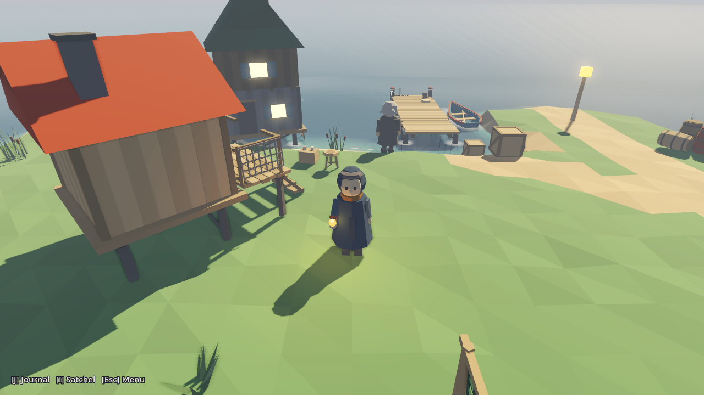

### After the burn: the founding knot  (`--scenario=aftermath_knot`)

The beacon burned the founding knot: nets begun in the middle, Hesk silent. Mara's aftermath scene is waiting, and Aldous is ready to tell the rest of his story.

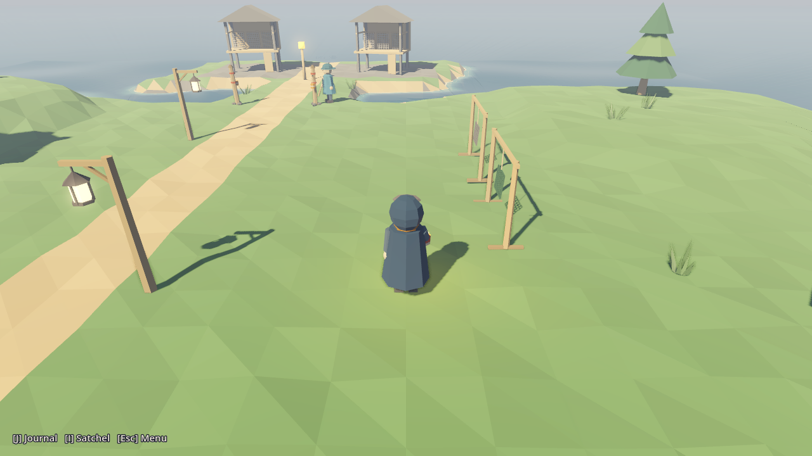

### The ferry's arrival  (`--scenario=ferry_arrived`)

Aldous confessed in full (you carry his sleeve-ember), Mara hung the green lantern and the Slow Mercy has put in. Talk to Oda Farrow at the dock end; Pell was promised a crossing.

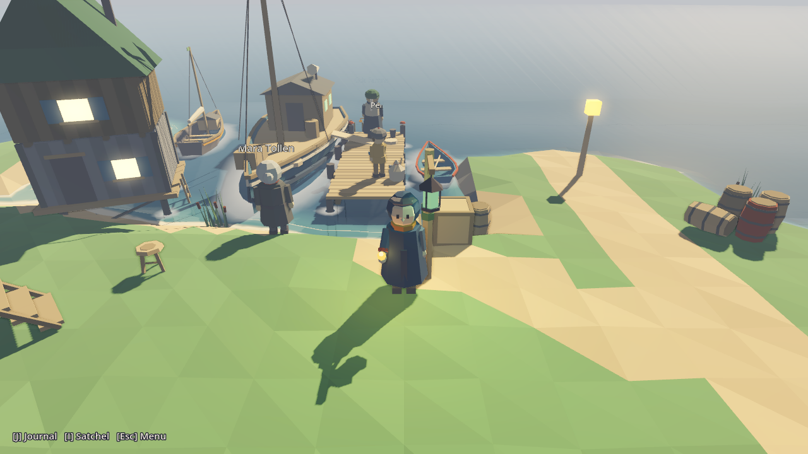

### The evening tide  (`--scenario=act_one_end`)

Deed weighed, Mara gave Pell leave, passage taken (Act I's end). Ask Oda to cast off for the crossing to Thornwold.

## Act II — The Drift

### Thornwold Landing  (`--scenario=thornwold`)

Just ashore after the crossing, with Pell along. Meet Bram Kettle at the lumber camp and look at the bramble wall across the cart road.

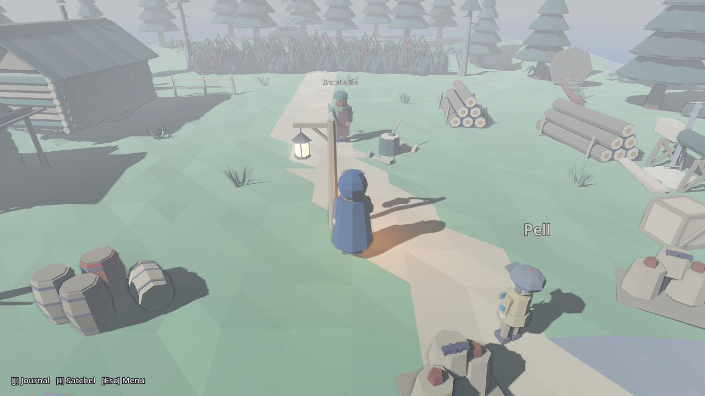

### Past the bramble wall  (`--scenario=thornwold_woods`)

Bram met; the ember parted the bramble wall. The straight road into the Greying, the waymark lanterns west to the colliers' clearing, Hob Marl and his clamp. Bram's salt not yet carried.

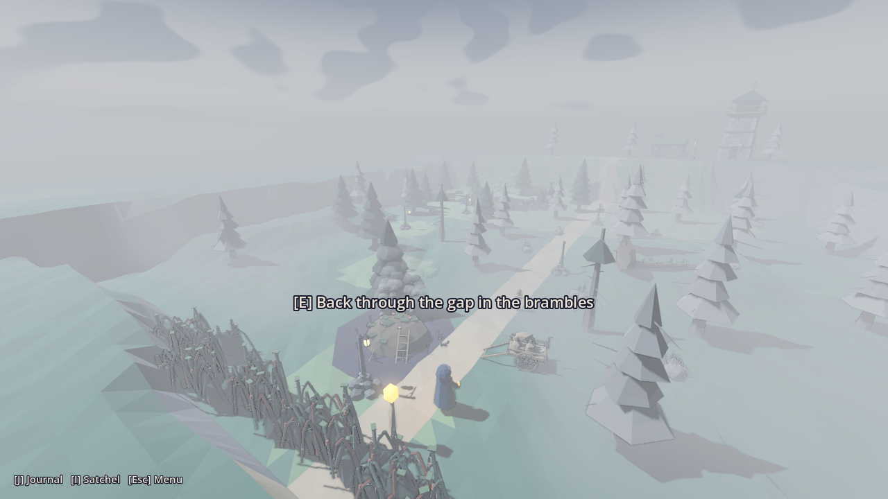

### The ridge and the Lamp  (`--scenario=thornwold_ridge`)

Hob met and paid; the Keepers' ladder stood and climbed. The ridge top in the Greying: the cold Ridge Light, the keeper's lodge, and the Lamp at the lantern bench. Ask about the iron box, the ladder, Aldous, and a lantern for the stair.

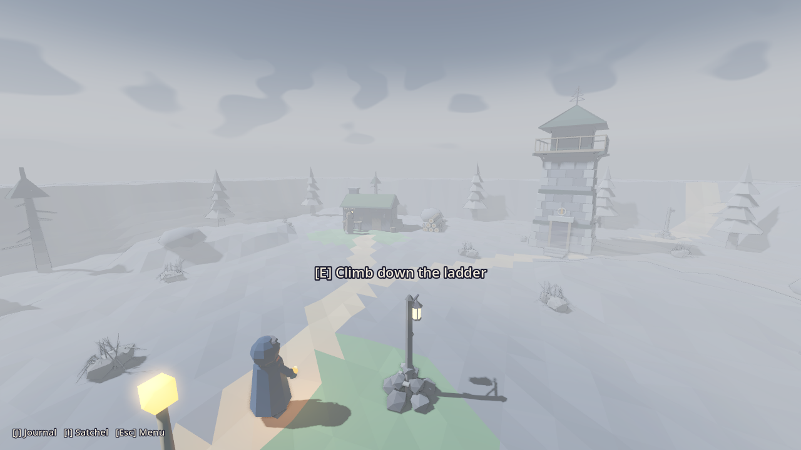

### The Ridge Light lit  (`--scenario=thornwold_lit`)

Thornwold's burning, the boots path: the Lamp met and asked; Hob gave Ottie's boots (his memory of the four colliers) and they burned in the Ridge Light. The tower gold, the fog leaning back. Go down to the woods and the camp: Hob comes in by daylight, Bram, Pell and Oda after the burn.

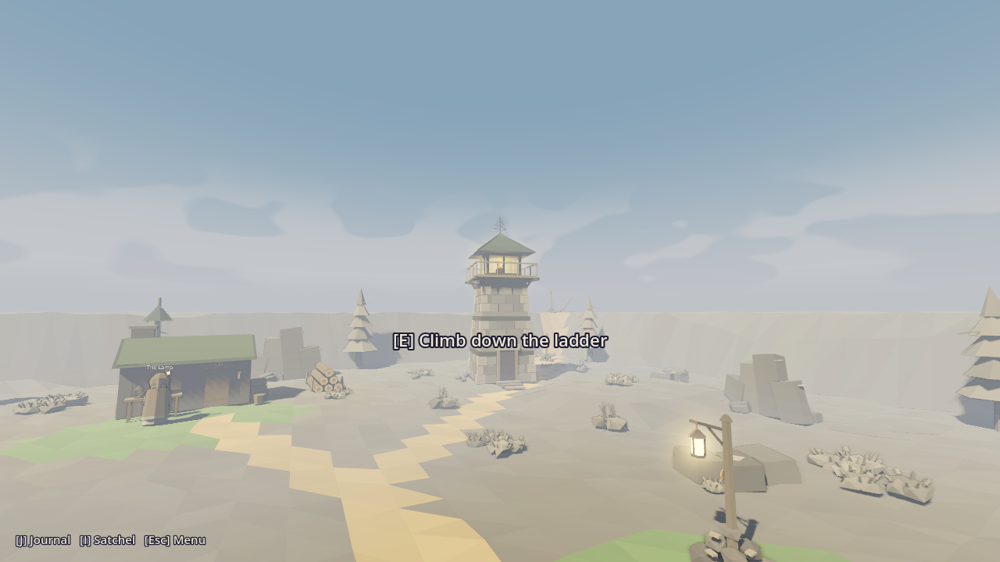

### Glasswater Fen  (`--scenario=glasswater_fen`)

Oda has sailed north-about from the lit Ridge Light to Glasswater Fen (boots path; Hob came in). Come ashore at the staithe: Hesper Vail of the Unmoored, Dunstan's rowboat, the letting post past the west walk, Corran Teal the eel-man, and the Heron Light dark out on the mere.

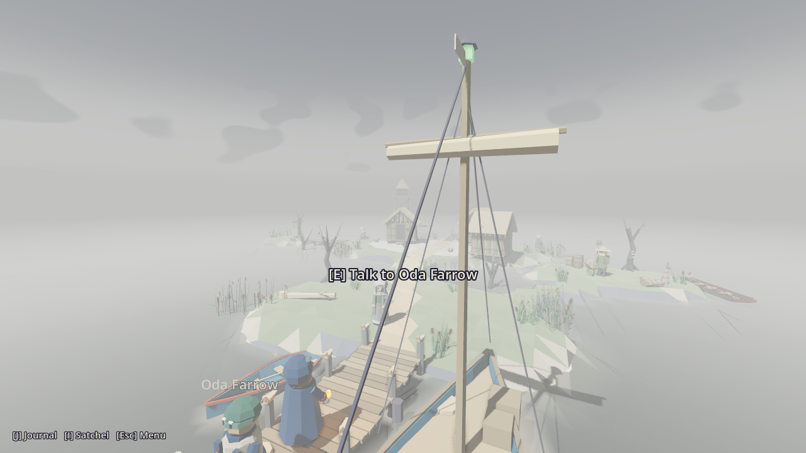

### Out to the Heron's legs  (`--scenario=heron_mere`)

Hesper met (the ember kept bare); Corran asked for his far trap, it lifted from the end of the long walk and brought back (in it, the keeper's skiff bell), and he has poled you out to the Heron Light. The Foot, the keeper's skiff (hang the bell or keep it), the scraped ladder, a big man at the fog's edge, Corran waiting by the punt.

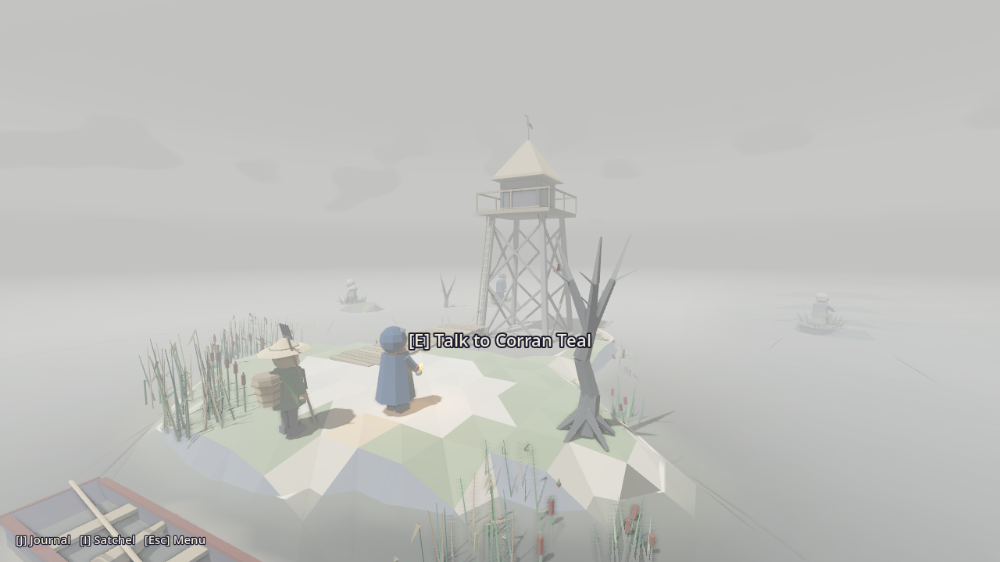

### The Heron Light, lit  (`--scenario=heron_lit`)

Back from the legs, Hesper told of a small light that goes up the Heron's ladder some nights; Corran held the foot on a dry day and you climbed to the cradle (cold put-down things, a whittled gull, the keeper's coat folded). Hesper gave her name; it fed the Heron. Lit, the fog leaning back off the mere; Corran waits to pole you back by its light; the bell hung back on her bow.

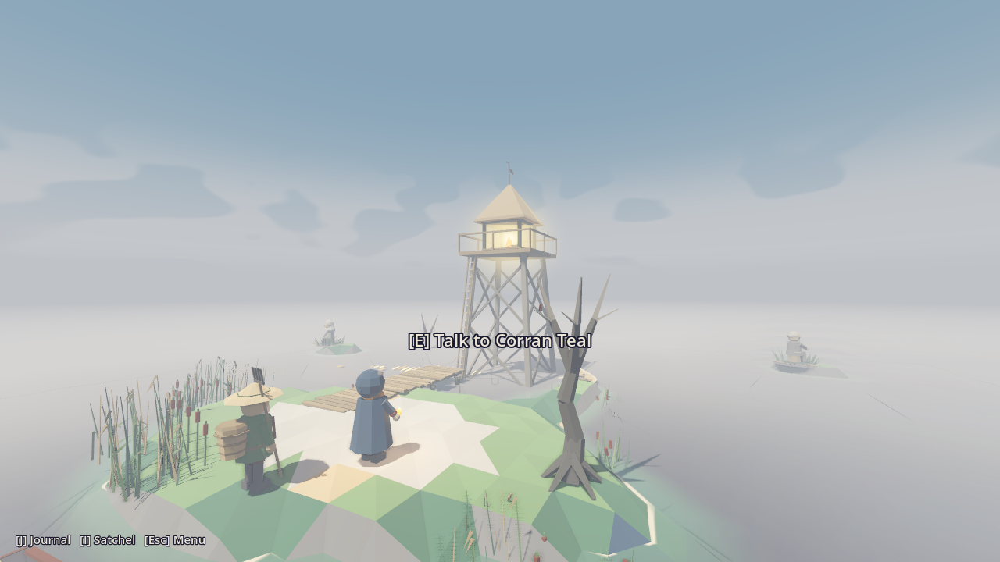

### For after: Dunstan found  (`--scenario=dunstan_found`)

Poled back by the Heron's light; the lantern lit at the fog's foot sits at the end of the long walk. Walk out along the boards: Dunstan Tollen on a tussock with his boots in the mere, whittling, the lantern lit beside him (Mara's word was left on the post, so a bit of red cord at his belt).

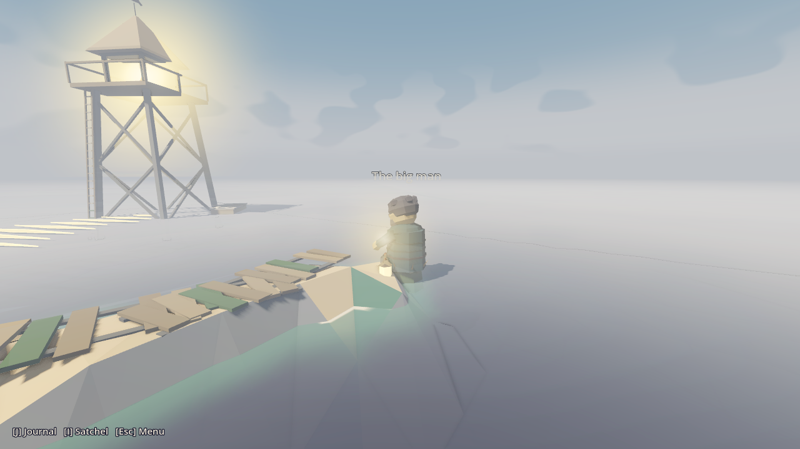

### East-about to Wrackholm  (`--scenario=wrackholm`)

Dunstan found (Mara's word carried: a gull for the stool; the rule kept). Oda sailed east-about from the lit fen and nobody answered her horn; she came in by soundings past the Teeth. The Tidewrights' yard is dark, the Gannet hauled up on the hard, the answering horn lashed shut by the lane-house door, Wenna Garrow sitting by it, Jory Pask stripping the Gannet's copper.

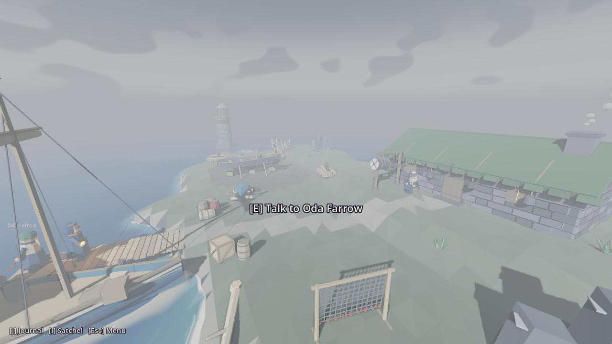

### The Teeth at the bottom of the springs  (`--scenario=the_teeth`)

The Gannet's crew named into the lashed horn (Jory told: it was Wenna's answer). Wenna remembered the white: nobody knew the Teeth by heart, you put your feet on the lampwardens' white-lead marks. Waited the spring tide down at the spit's end; the ember brought the marks back rock to rock; crossed on the white. Walk the reef road west to the Wrack's stack and climb to its lantern room.

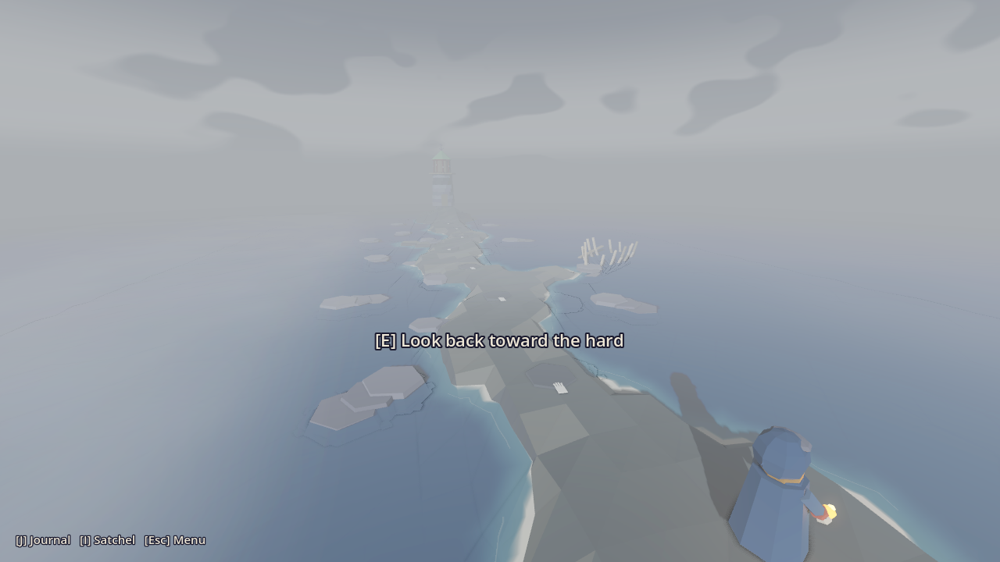

### The Wrack lit, the horn answered  (`--scenario=wrack_lit`)

Wenna and Jory gave together (her answer, his pot); the Gannet's board stayed on her transom. Hale's white-lead pot burned in the Wrack's cradle: the Wrack Light burns gold over the Teeth, the fog leaning back; Jory no longer remembers going out on the white. Talk to Wenna to unlash and sound the answering horn, open the lane-house Book, and be sworn a friend of the lanes.

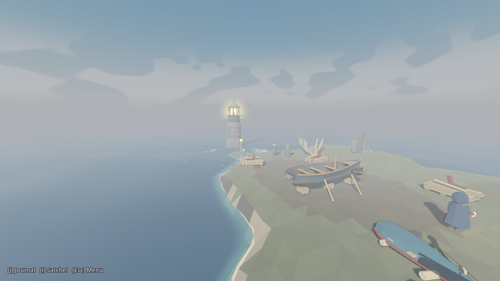

### The Lamp's name carried home  (`--scenario=lamp_named`)

The horn answered, the Book opened (the Lamp's page read: WYNN SALLOW), sworn a friend of the lanes; Oda sailed back west by the fen to Thornwold. On the ridge the player said the name outright: the Lamp has put its hood back and remembers the novice on the east stair who told it to keep a coal back. Oda, at the landing, has a word for a sworn friend carrying fares home.

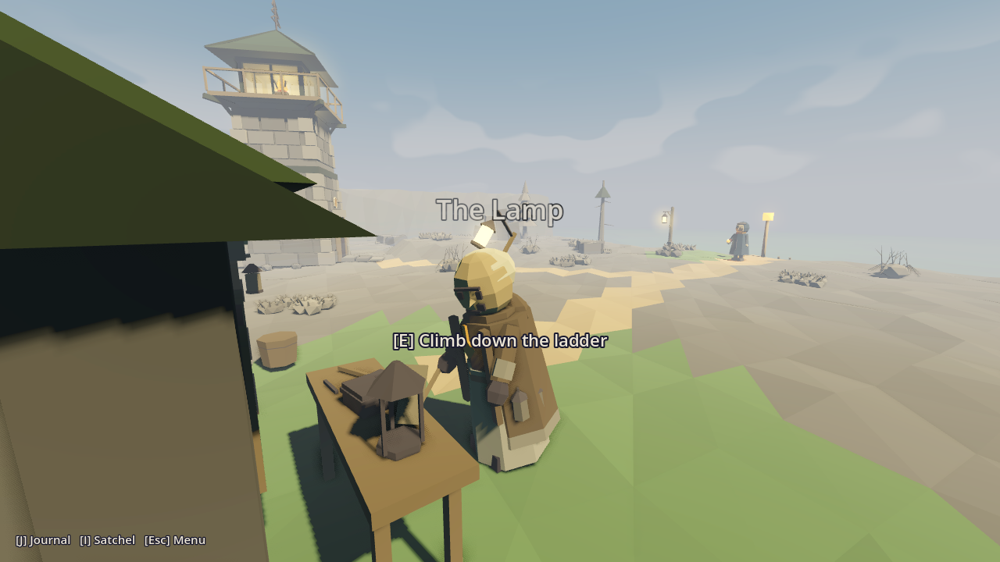

### The East Stair  (`--scenario=east_stair`)

Oda sailed the player back from Thornwold to Saltmarrow. On his bench by the Wrens' steps Aldous heard that Wynn Sallow is alive, counted six novices on the east stair by name and a seventh light with no face, and was asked 'could it have been me?' He couldn't find the player's face anywhere. He told of the novices' roll in the warden's niche on Cindermoor and laid the Wrens' brazier for whoever comes down the stair.

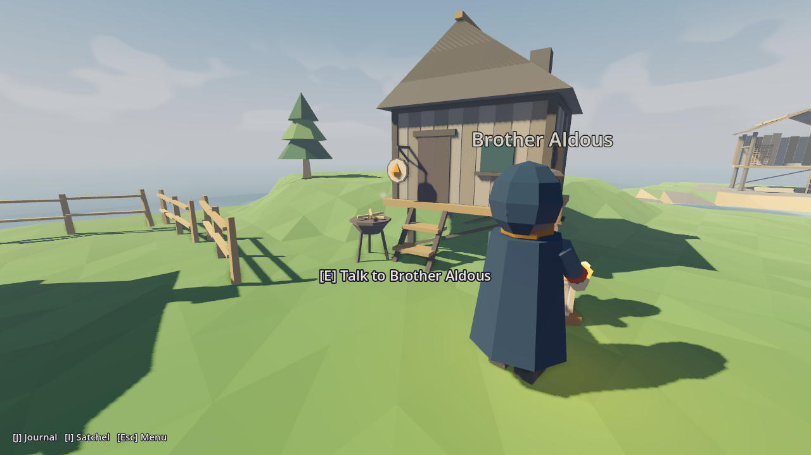

### The Fifth  (`--scenario=the_fifth`)

The salt-row path instead of the boots (Thornwold's burning re-chosen for this checkpoint): Bram's camp no longer knows the colliers, Hob still keeps the four. Back on Thornwold after the east stair, Hob was asked up the ladder from the tally-house step (Pell gave his count-stick back); on the ridge the Lamp told him he is the fifth and gave him a lantern of his own lit off the Ridge Light. He stands at the ladder's head with it, waiting on the player's word: go after the four, or stay at the bottom of the road.

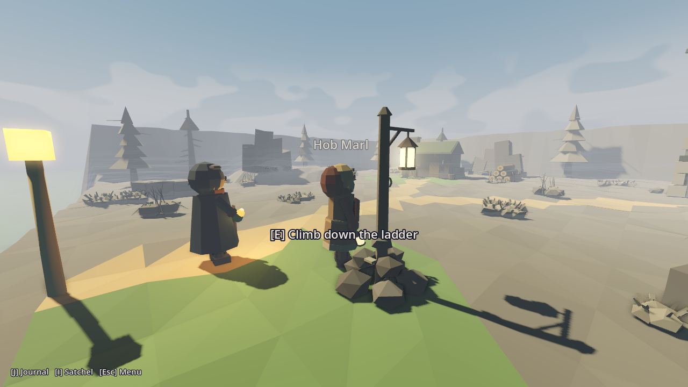

### The Walk Back  (`--scenario=the_walk_back`)

After the east stair Oda sailed the player back to the fen. Dunstan's lantern had come halfway in along the long walk and stopped (the boards are laid for going in); the player walked ahead of him with the ember, and he stands at the staithe's foot in front of Hesper to ask for his name himself. Talk to him: Hesper gives it back, and the player's word sends him home to Saltmarrow or keeps him turning the boards.

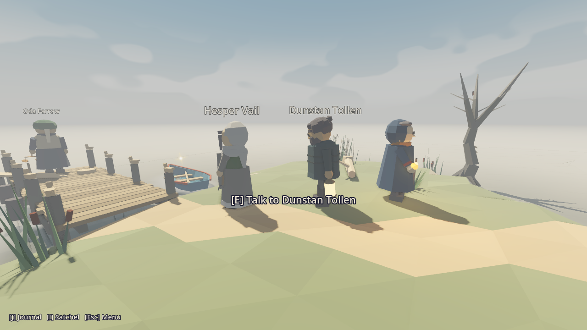

### Word on the Water  (`--scenario=word_on_the_water`)

After The Walk Back, Dunstan rowed home to Saltmarrow facing backward and sits on his stool by Mara's door; Tam rang the gate bell for him, Hesk saw the Tollen shoulders come home, Aldous watched from his bench. The player carried Dunstan's word to Oda ("not laughing at the weather") and the Slow Mercy lies at the dock. Oda has sent word back: his berth's still swung. Carry it to him, and his answer back to her.

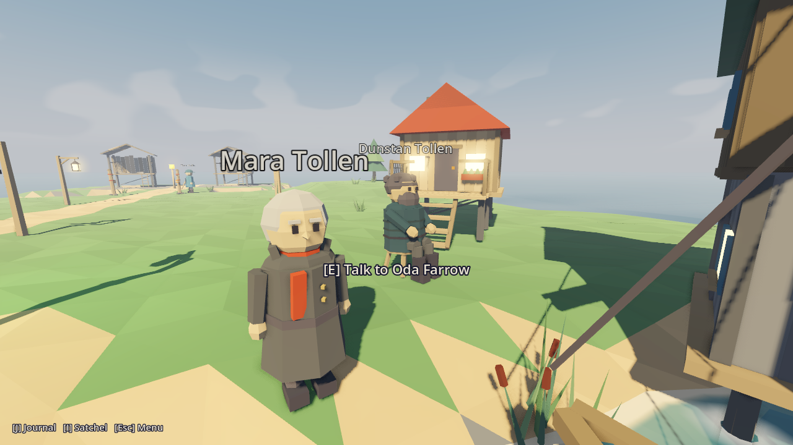

### The Northing  (`--scenario=the_northing`)

After The Fifth (Hob gone up the old road with his lantern), the player walked the old Keepers' road north along Thornwold's spine to the Northing, the Keepers' fire-cairn on the north cliff, and found Ottie Swale keeping a charcoal fire in its basket for the three who went down to the far shore. The Lamp lit a lantern off the Ridge Light for him. Carry it up the spine and give it to Ottie: hang it on the Northing (he goes home to his boots) or put it in his hand (he takes it down the steps).

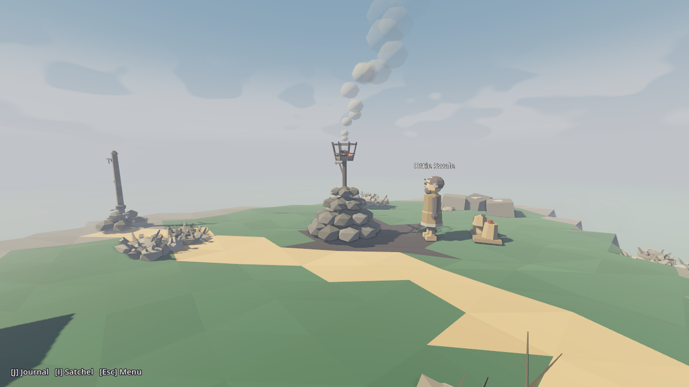

### The Far Shore  (`--scenario=the_far_shore`)

After The Northing (Ottie took the Ridge Light's lantern down the Keepers' steps; Hob went down before him), the player went down the steps to the far shore under the Northing's cliff and found Wenna Coll on the end of the Keepers' boat-stage waiting for the Spire's boat, the Drays arguing by a driftwood fire, Ottie under the lantern he hung on the stage's bracket and Hob counting heads. Tell Wenna what you think: come up (the Lamp breaks the warm side of its kept coal for their hearths) or wait (and tell the Spire they're there).

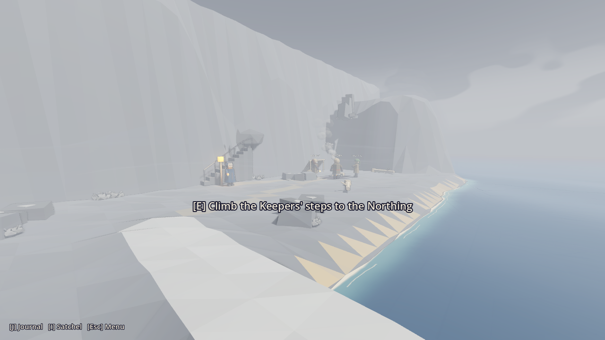

### The Bend in the Road  (`--scenario=the_bend_in_the_road`)

After The Far Shore (the three came up; the Lamp broke the warm side of its coal for their hearths), Wenna Coll walked out at first light with her lantern and found the old bend in the cart road the Snuffing straightened: her hearth, a cold hut, a clamp burned clean through while she walked round it. Help her decide where her one light goes: on the bend's waymark (the road a road again) or by her own door (a light of her own).

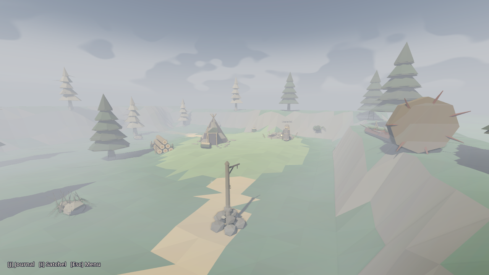

### Kindleby  (`--scenario=kindleby`)

After the Wrack was lit, Oda told of the lane on: south-about down the Taper to Kindleby, the Keepers' mother-house. The quay bell answered before she blew; the island is ringed with candles and the fog stands a cable's width off. Brother Tobin at the bell; Provost Agathe Lorn at the chapter-house, who will ask the Wakebearer to bow to the rite.

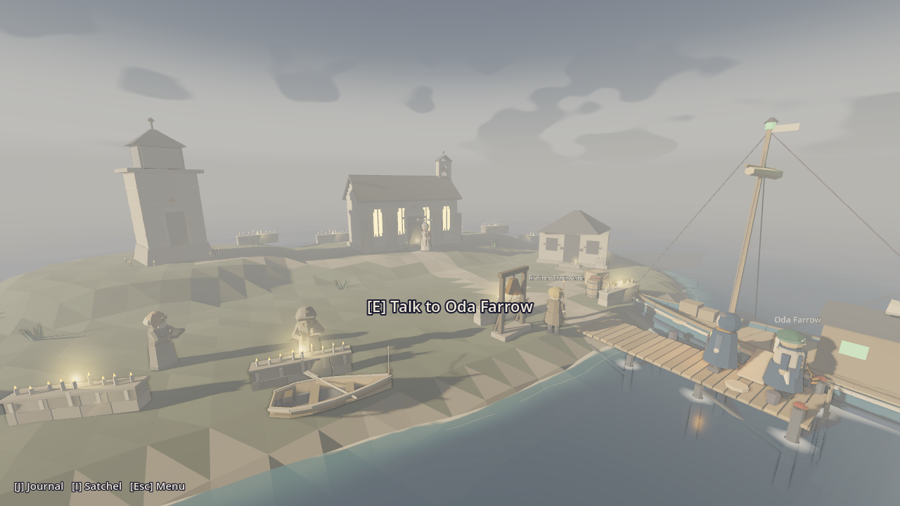

### Kindleby's burning  (`--scenario=kindleby_lit`)

The Wakebearer held the ring from the crown while the chapter sat; the chapter chose Kindleby's night of the boats, old Brother Anselm carried the lantern into the fog, and the Wakebearer (having bowed to the rite) burned it in the Vigil Light. The fog leans back off the island; nobody on Kindleby remembers how the old ones came over.

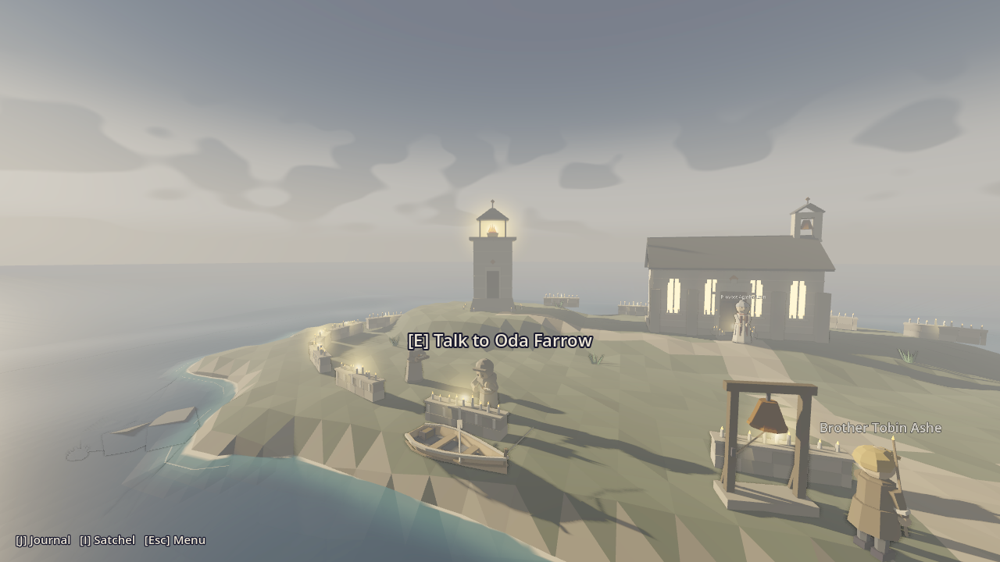

### The skiff at the stage  (`--scenario=skiff_in`)

The colliers were told to wait on the Northing's stage, and the Provost of Kindleby was told of them; while the chapter sat, the chapter's skiff rowed north. It's tied up at the stage's ring now, Sister Hild and Sister Pim with oil, meal and a lantern, and Wenna Coll wants telling: home, or Kindleby.

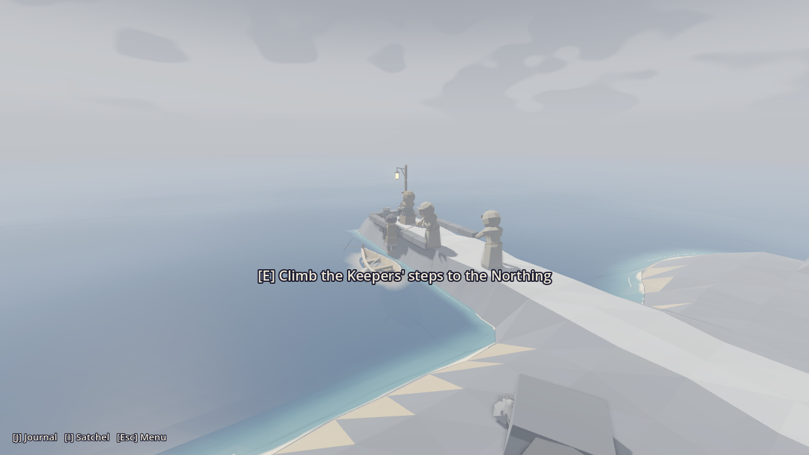

### Colliers on the candles  (`--scenario=colliers_on_kindleby`)

Wenna told to go with the sisters: everyone on the far shore got into Kindleby's skiff. Wenna and Abe keep candles on the west wall, Tolly on the east by the Quiet House, Hob counts them all, and Ottie looks north from the quay.

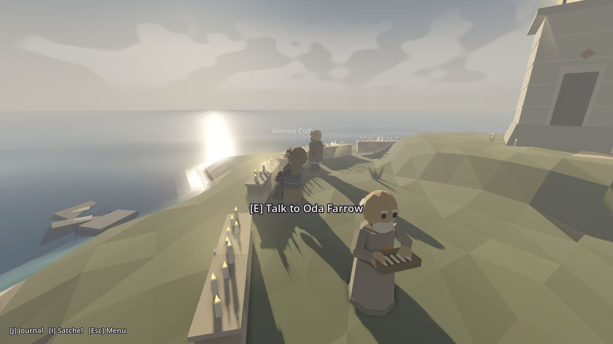

### What the ember keeps  (`--scenario=the_stair_taper`)

Kindleby lit: as the Vigil Light caught, its smoke closed round the Wakebearer's hand and left a notched novice's stair-taper in it, humming with a memory of the Wakebearer's own. The Provost, Brother Tobin and (on Saltmarrow) Brother Aldous know what it is.

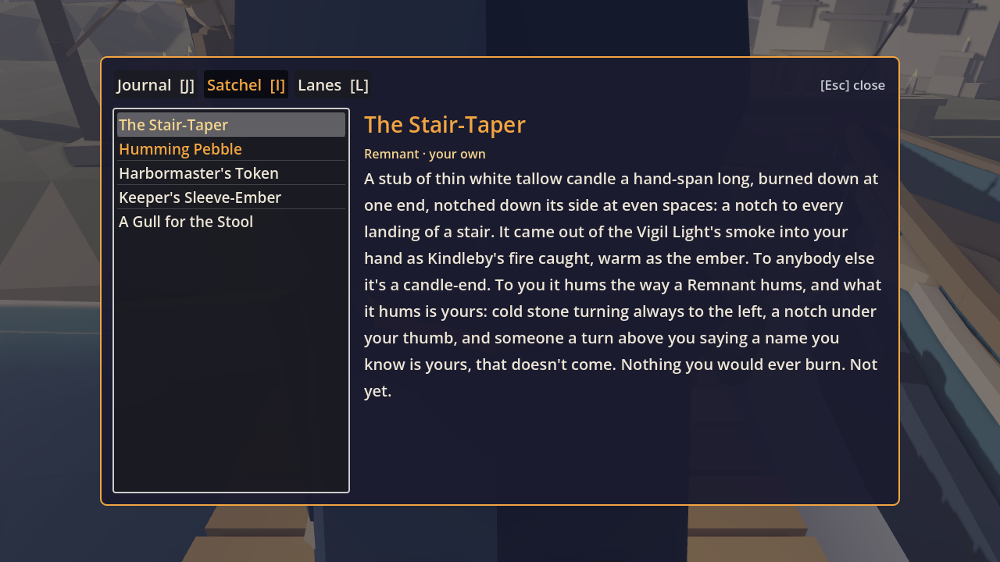
